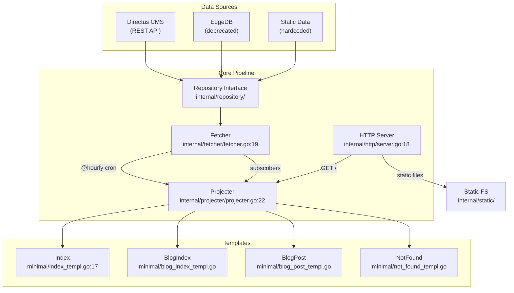

# Architecture

## Overview

Personal website ([michael.jules.mu](https://michael.jules.mu)) built with Go, using a pre-rendered HTML architecture with in-memory caching for maximum performance.

> For the curious. Yes, it's over-engineered on purpose — this is a playground for experimentation.

## Architecture Pattern

All pages are pre-rendered into memory at startup and refreshed every hour. HTTP requests are plain memory lookups — no per-request templating.

```
Repository (Directus/EdgeDB/Static)
    └── Fetcher (concurrent fetch, hourly cron, in-memory cache)
          └── Projecter (pre-rendered HTML, gzip compressed)
                └── HTTP Server (serves from memory)
```

## Functional Areas

### 1. HTTP (`internal/http/`)

| Component | File | Lines | Description |
|-----------|------|-------|-------------|
| Server | server.go | 18-28 | Main server struct with mux, auth, fetcher, projecter |
| NewServer | server.go | 30-64 | Dependency injection, route registration |
| Start | server.go | 66-85 | Server startup with endless, TLS support |
| initRoutes | server.go | 87-93 | Route mapping to handlers |
| rootHandler | handler.go | 10-29 | Request routing to projections, static file fallback |
| notFoundHandler | handler.go | 31-42 | 404 handling via projecter |

### 2. Fetcher (`internal/fetcher/`)

| Component | File | Lines | Description |
|-----------|------|-------|-------------|
| Fetcher | fetcher.go | 19-40 | Caches all entity data with RWMutex protection |
| New | fetcher.go | 42-61 | DI setup, hourly cron registration |
| Fetch | fetcher.go | 87-299 | Concurrent data fetching via goroutine pool |
| Start/Stop | fetcher.go | 63-69 | Cron lifecycle management |
| AddSubscriber | fetcher.go | 71-75 | Projecter subscribes to rebuild on fetch |

**Data Types Cached:** Meta, Links, Introduction, Sections, Experiences, Projects, Contributions, Awards, Interests, Languages, Posts

### 3. Projecter (`internal/projecter/`)

| Component | File | Lines | Description |
|-----------|------|-------|-------------|
| Projecter | projecter.go | 22-29 | Map of gzipped HTML projections |
| New | projecter.go | 31-49 | DI setup, initializes empty projections map |
| Build | projecter.go | 51-82 | Renders all pages (index, blog, posts, 404) |
| Get | projecter.go | 84-98 | Memory lookup; rebuilds in dev mode |
| render | projecter.go | 100-117 | Gzip compression + storage |

### 4. Repository (`internal/repository/`)

Three implementations with priority: EdgeDB > Directus > Static

| Implementation | Description |
|---------------|-------------|
| directus/ | REST API client using resty, configurable via env |
| edgedb/ | Graph database client (deprecated, takes priority if DSN set) |
| static/ | Hardcoded fixture data for local dev without CMS |

### 5. Entities (`internal/entity/`)

Domain models for all content types:

| Entity | File | Description |
|--------|------|-------------|
| Meta | meta.go | Site metadata |
| Link | link.go | Navigation/social links |
| Introduction | introduction.go | Hero section content |
| Section | section.go | Page sections |
| Experience | experience.go | Work history |
| Project | project.go | Portfolio projects |
| Contribution | contribution.go | Open source contributions |
| Award | award.go | Achievements |
| Interest | interest.go | Personal interests |
| Language | language.go | Programming languages |
| Post | post.go | Blog posts |
| Tag | tag.go | Post tags |
| Technology | technology.go | Tech stack |
| User | user.go | User model |

### 6. Templates (`internal/templates/minimal/`)

| Component | File | Description |
|-----------|------|-------------|
| Index | index_templ.go:17 | Main page with experience/project sections |
| BlogIndex | blog_index_templ.go | Blog listing page |
| BlogPost | blog_post_templ.go | Individual blog post |
| NotFound | not_found_templ.go | 404 error page |
| Base | base_templ.go | Shared layout, header, footer, markdown renderer |

### 7. Auth (`internal/auth/`)

Token-based authentication for protected endpoints. Configured via `AUTH_TOKEN` environment variable.

## Key Execution Flows

### 1. Server Startup

```
main (cmd/serve/main.go)
  └── NewServer (internal/http/server.go:30)
        └── initRoutes (internal/http/server.go:87)
              └── rootHandler (internal/http/handler.go:10)
                    └── projecter.Get (internal/projecter/projecter.go:84)
                          └── Build (internal/projecter/projecter.go:51)
                                └── Index (internal/templates/minimal/index_templ.go:17)
                                      └── DeepCopy (internal/fetcher/deepcopy.go)
```

### 2. HTTP Request

```
HTTP Request
  └── rootHandler (internal/http/handler.go:10)
        └── projecter.Get (internal/projecter/projecter.go:84)
              └── Memory lookup
                    └── renderHTML (internal/http/server.go)
```

### 3. Hourly Refresh

```
Cron (@hourly)
  └── Fetch (internal/fetcher/fetcher.go:87)
        └── Concurrent repo calls
              └── notify (internal/fetcher/fetcher.go:77)
                    └── Projecter.Build (internal/projecter/projecter.go:51)
```

## Mermaid Diagram



## Dependencies

| Package | Purpose |
|---------|---------|
| github.com/a-h/templ | HTML templating |
| github.com/panjf2000/ants/v2 | Goroutine pooling |
| github.com/robfig/cron/v3 | Hourly refresh |
| github.com/fvbock/endless | Zero-downtime server restart |
| golang.org/x/crypto/acme/autocert | Let's Encrypt TLS |
| github.com/cenkalti/backoff/v4 | Retry logic with exponential backoff |
| github.com/go-resty/resty/v2 | Directus REST client |
